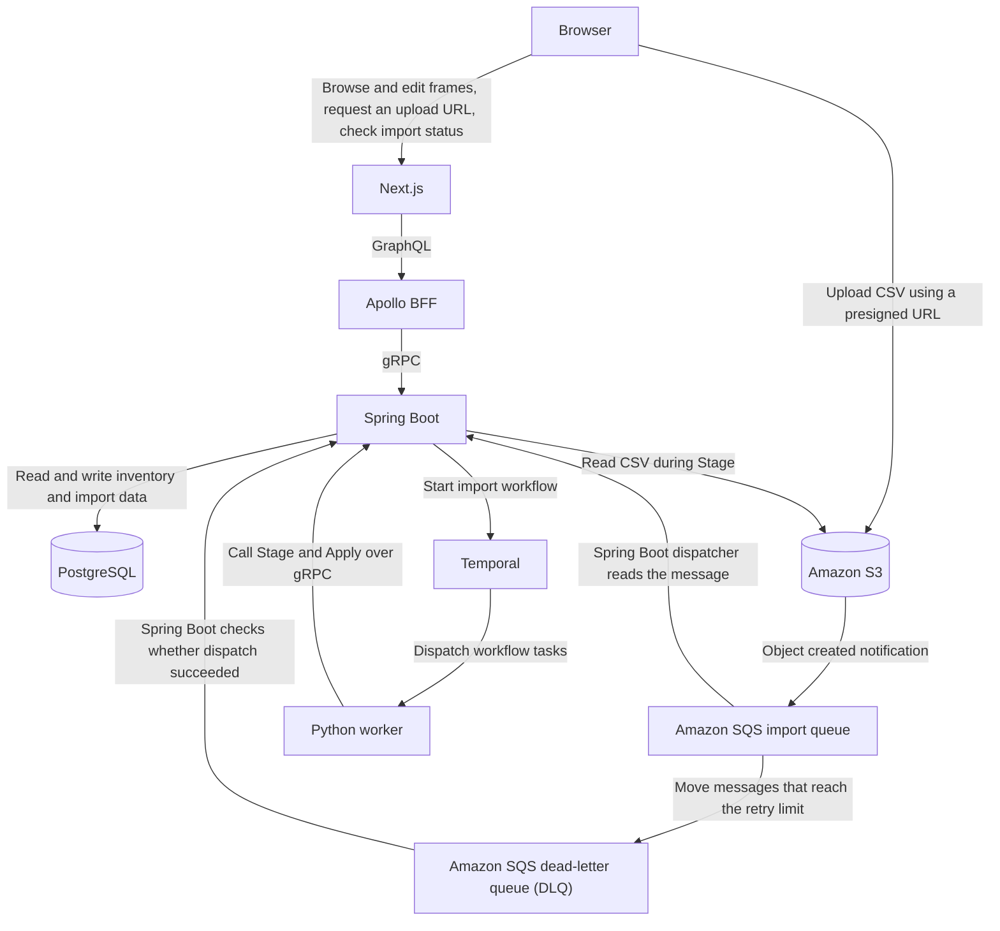

# Frame Inventory

Use Frame Inventory to add and edit frames, import inventory from a CSV file,
and see which fields changed between versions. You can also search for frames,
filter them by status and open each frame's detail page.

[Exercise requirements](./INSTRUCTIONS.md) · [Sample inventory export](./data/inventory_frame.csv)

## Prerequisites

To run the full stack, install Docker with Docker Compose v2, for example
[Docker Desktop](https://www.docker.com/products/docker-desktop/). Compose
builds every service, so you do not need other runtimes on the host.

These tools are optional.

| Tool | When you need it |
| --- | --- |
| [`just`](https://github.com/casey/just) and `openssl` | To run `just up`, which creates a local import token. |
| Java 21 | To run the backend or its tests on the host. The Gradle wrapper downloads Gradle. |
| Node.js 22.12 or newer | To run the frontend or BFF on the host, and for the Commitlint hook. |
| Python 3.12 and [`uv`](https://docs.astral.sh/uv/) | To run the Temporal worker on the host. |
| [`pre-commit`](https://pre-commit.com/#installation) | To install the Git hooks. |

## Run the application locally

From the repository root, run the following command to build and start the
stack. You can run it without an `.env` file or with a copy of `.env.example`.

```bash
docker compose up --build
```

Once PostgreSQL is ready, the backend applies pending Flyway migrations. Open the
frame list to browse the inventory. The root URL redirects to `/frames`.
[Local frame list](http://localhost:3000/frames)

To upload a CSV, start the stack with a local import token and open `/imports`.
The Imports page tells you how to enable uploads if they are disabled. Bookmark
`/imports/<jobId>` to reopen a job and enter the token to see its results.
[CSV import smoke test](#csv-import)

If you have `just` installed, run `just` to list the available commands.

| Command | What it does |
| --- | --- |
| `just up` | Creates a local import token if needed, then builds and starts the stack. |
| `just down` | Stops the stack and keeps its named data volumes. |
| `just compose logs -f backend` | Passes arguments to Docker Compose, in this case to follow the backend logs. |
| `just migrate` | Runs Flyway in a one-off backend container. |

## Repository contents

The repository contains the application, the design system and the design
documents.

- [application source](./src/README.md) for the Spring Boot backend, Apollo Server and Next.js frontend
- [design system](./design-system/README.md) with the prototype, sample frame data and visual conventions
- [design documents](./docs/designs/) for the inventory schema, frame management API and CSV import

## Services

Docker Compose starts these services and publishes the listed host ports.
The BFF shares the backend's network, so the backend publishes port 4000.

| Service | Host port | Container port | What it does |
| --- | --- | --- | --- |
| `frontend` | 3000 | 3000 | Serves the Next.js workspace and its same-origin GraphQL route. |
| `bff` | 4000 | 4000 | Serves Apollo Sandbox and the inventory GraphQL API. |
| `backend` | 8080, 9090 | 8080, 9090 | Runs Spring Boot and serves `GET /api/health` and the gRPC API. |
| `postgres` | 5432 | 5432 | Stores the inventory schema that Spring Boot applies through Flyway. |
| `aws` | 4566 | 4566 | Emulates Amazon S3 and Amazon SQS, including the import queue and its dead-letter queue. |
| `temporal` | 7233, 8233 | 7233, 8233 | Serves the Temporal gRPC API and web interface. |
| `workflows` | | | Runs the Python Temporal worker for `DELTA` imports. |
| `prometheus` | 9091 | 9090 | Scrapes Spring Boot and Apollo metrics every 15 seconds. |
| `otel-collector` | 9464 | 9464 | Exposes Spring Boot metrics for local inspection. |
| `grafana` | 3001 | 3000 | Queries the configured Prometheus and Loki data sources. |
| `loki` | | | Stores backend and BFF logs. |
| `alloy` | | | Collects container logs and sends them to Loki. |

Compose creates named volumes for PostgreSQL, Prometheus, Grafana, Loki and
Alloy. [Docker Compose configuration](./docker-compose.yml)

### Local credentials

| Service | User | Password | Database |
| --- | --- | --- | --- |
| PostgreSQL | `app` | `app` | `frames` |
| Grafana | `admin` | `admin` | |

## Design decisions

### How services communicate

Amazon S3 sends a notification to the Amazon SQS queue when a CSV upload
finishes. The Spring Boot dispatcher reads the notification and starts the
Temporal workflow.



Next.js serves the inventory and import workspace. Its `/api/graphql` route
forwards requests to the Apollo backend for the frontend (BFF). Compose sets
`BFF_URL` to `http://bff:4000`. Next.js forwards other `/api/` requests to
`BACKEND_URL`, keeping the path intact. Compose sets that URL to
`http://backend:8080`. [Next.js rewrites](./src/frontend/next.config.ts)
[Docker Compose configuration](./docker-compose.yml)

The workspace loads the first page of frames when you open it. When you upload
a CSV, the browser sends the file straight to S3 using a signed URL from the
BFF.

GraphQL gives the frontend an API shaped around its screens. The BFF calls
Spring Boot over gRPC, which gives the services a typed contract and keeps
inventory rules in Spring Boot.

gRPC sends compact Protobuf messages and shares long-lived HTTP/2 connections
across calls. This reduces overhead compared with JSON over HTTP/1.1. Server
streaming lets `Stage` report progress while the backend reads a large CSV.

The `.proto` files define the contract. They generate Java code for Spring Boot,
TypeScript for the BFF and Python for the import worker. Code generation helps
catch incompatible contract changes during builds. gRPC deadlines, status
codes and metadata give services a consistent way to handle timeouts, errors
and correlation IDs.

The BFF adds a network call and a GraphQL schema (`.gql`) to keep in step with
the Protobuf schema. Generating code from both schemas helps keep them aligned.
The BFF also lets the browser use GraphQL because browsers cannot call native
gRPC directly. Use a tool such as `grpcurl` to inspect binary messages.

### PostgreSQL and version history

The exercise offered MariaDB and MongoDB. I chose PostgreSQL because it can
compare and update batches of imported rows in SQL.
The legacy export has a stable relational structure, which suits a fixed
schema managed through migrations.

Each frame has a stable identity in `frame` and a history in `frame_version`.
Each version records `valid_from` and `valid_to`. A partial unique index
allows at most one current version for each frame. An edit or import closes
the current version and adds a new one. A delete closes the version, and
`closed_by_change_source` records why it closed.

The application reads the same versions that make up the audit trail. Partial
unique indexes, `CHECK` constraints, row locks and advisory locks enforce
versioning rules in the database. Each change copies the full row. The history
view compares consecutive versions to show which fields changed.

Lookup tables store formats and the location hierarchy of country, region,
town and postcode. Versioned child tables keep Broadsign references, pricing
references and links to other frames queryable.

### Concurrent edits

Each edit includes the version it started from. The backend locks the frame
row and rejects the edit if a newer version exists. The interface then offers
to reload the latest version.

Every writer takes a shared lock for its transaction. A future full snapshot
import can take that lock exclusively.

### Inventory search

PostgreSQL searches current versions for a case-insensitive substring in the
frame ID or town. You can also filter the results by status. I removed
OpenSearch from the exercise scaffold because the search requirements and time
available did not justify a second data store and a pipeline to keep it in
sync.

The leading wildcard in the `ILIKE` query prevents PostgreSQL from using a
B-tree index, so it scans current rows. This is sufficient for about 1,000
frames. A `pg_trgm` index would be the next step and would run in PostgreSQL.

If search outgrew PostgreSQL, I would use Kafka change data capture to stream
committed changes from `frame_version` into OpenSearch. The application would
still write to PostgreSQL alone. A scheduled Prefect flow would compare the
search index with PostgreSQL and correct any differences.

### CSV import pipeline

The browser uploads the CSV directly to S3 using a presigned URL. S3 sends a
notification to SQS, and Spring Boot starts a Temporal workflow. A Python
worker runs the workflow and calls the backend's `Stage` and `Apply` gRPC
methods.

#### SQS retries and the dead-letter queue

S3 sends upload notifications to `inventory-import`. Spring Boot acknowledges
each message after it handles all applicable records. If dispatch fails, SQS
allows up to 5 receives before moving the message to `inventory-import-dlq`,
the dead-letter queue (DLQ).

Spring Boot also reads the DLQ. It checks whether Temporal already started the
workflow and preserves the job if it finds an execution. If Temporal confirms
there is no execution, Spring Boot can mark the job as failed. For jobs already
bound to an uploaded object, it waits until the dispatch deadline.
[Local SQS dispatch settings](./src/backend/README.md#local-sqs-dispatch)

#### Staging and applying rows

`Stage` streams the CSV from S3 outside the user's request and validates each
row as it reads it. It writes batches of 200 rows to `UNLOGGED` staging
tables, keyed by job, attempt and row number. These tables skip the
write-ahead log and hold the rows until the apply step finishes.

`Apply` validates the staged data and compares it with current versions in one
transaction. It updates lookup tables with `INSERT … ON CONFLICT`, closes
replaced versions with `UPDATE … FROM` and inserts new versions with
`jsonb_populate_record`. It also records row errors. The transaction uses a
fixed number of SQL statements, so it avoids a separate database call for
each row. It resolves each distinct location and format once and skips
unchanged rows.

Temporal retries each step. Re-uploading an unchanged file creates no new
versions, and a retried attempt cannot apply twice.

The backend accepts files up to 10 MiB and 10,000 rows. To support larger files,
raise the limits and measure how long the apply transaction takes. For the
supplied 1,000-row file, an HTTP handler could parse the upload in the
application and apply it with the same staging SQL. I chose the workflow to
exercise the production design, which requires more services locally.

#### Import conflict rules

The backend uses source timestamps and row content to decide what to do.

- A newer timestamp creates a version.
- The same timestamp and content leave the current version unchanged.
- An older timestamp or different content with the same timestamp requires the operator to choose force overwrite.
- The backend rejects invalid rows individually and still applies valid rows.
- Manual edits use the current time, so an older export cannot silently undo them.

#### Full snapshot imports

A `FULL_SNAPSHOT` import would retire frames missing from the file. The design
limits how many frames an import can retire and sets a threshold for malformed
rows. It also tracks the latest snapshot for each scope. The API rejects the
mode until these checks are in place.
[Full snapshot import design](./docs/designs/full-snapshot-import-design.md)

#### Local import access

The BFF and the backend share a local import token. The backend accepts it only
from the BFF over loopback.

### Metrics and logs

Prometheus, Grafana, Loki and the OpenTelemetry Collector provide dashboards,
metrics and centralised logs with correlation IDs. Inventory metrics cover
frame creation, edits, soft deletes and import outcomes. Alert rules are a
[follow-up](#follow-ups).

### Working with AI

I tracked features, fixes and follow-ups on a Linear board. Each ticket has
acceptance criteria and maps to a branch (`alex/glo-<n>-…`) and a pull request.
Commits reference their tickets.

I split the work into small, independent tickets and assigned each agent its
own ticket branch. I checked every change against the acceptance criteria
before merging. GitHub Copilot provided a second review for pull requests on
the backend, BFF, monitoring and import pipeline. I reviewed its comments and
decided which changes to apply. The open tickets form the [follow-up list](#follow-ups).

Before starting significant work, I wrote a design document and reviewed it
using the Elephant–Goldfish Model (EGM). Reviewers with fresh context assessed
the design, readiness to implement and opportunities to simplify. The
documents record open questions and alternatives I considered.
[Alternatives considered for bulk CSV import](./docs/designs/bulk-csv-inventory-import-design.md#alternatives-considered)

The `Entire-Checkpoint:` trailer links a commit to its Codex session. Entire
stores sessions as Git refs under `refs/entire/checkpoints/`. To fetch them, run
`git fetch origin 'refs/entire/*:refs/entire/*'`.

### Follow-ups

The remaining work covers access, imports, data checks, monitoring and builds.

- add user sign-in and role-based permissions for editing and importing, and record the user on each `frame_version`
- implement `FULL_SNAPSHOT` imports, including retirement limits, ordering within each scope and replay protection
- use feature flags to enable changes such as `FULL_SNAPSHOT` by environment or import scope, expand the rollout in stages and turn changes off without redeploying
- schedule Prefect flows to compare derived data, such as a future search index, with PostgreSQL and correct differences
- add Grafana alerts for failed imports, stuck jobs and error rates, plus distributed tracing with Grafana Tempo and more metrics from Temporal
- run each GitHub Actions workflow only when its part of the repository changes

## Verify the application

Run `./gradlew test` from `src/backend`. From `src/frontend`, install the
dependencies and run `npm run lint`.

### Git hooks

Install pre-commit, then run `pre-commit install` from the repository root to
install both Git hooks. [pre-commit installation guide](https://pre-commit.com/#installation)

The `pre-commit` hook checks YAML, JSON and merge conflict markers. It runs
ESLint when staged changes touch `src/frontend/`. Before committing frontend
changes, install the frontend dependencies with `npm ci --prefix src/frontend`.

The `commit-msg` hook uses Commitlint to check the Conventional Commits format.
Commitlint requires Node.js 22.12 or newer. [Repository commit guidelines](./AGENTS.md)

Run `pre-commit run --all-files` to check the whole repository.

### Smoke test

After the stack starts, check the frontend, backend and GraphQL API.

- Open the [frame list](http://localhost:3000).
- Check the [backend health endpoint](http://localhost:8080/api/health).
- Run the frame list query in Apollo Sandbox. [Frame list query](./src/bff/README.md) · [Apollo Sandbox](http://127.0.0.1:4000)

#### CSV import

1. From the repository root, run `just up` or `sh scripts/compose-up.sh` if you
   do not have `just`. The script uses OpenSSL to create
   `INVENTORY_IMPORT_LOCAL_TOKEN` in `.env` if you have no token.
2. Open the [local workspace](http://localhost:3000) and select **Imports**.
   Paste the value of `INVENTORY_IMPORT_LOCAL_TOKEN` from `.env` into
   **Local operator token**.
3. Choose the [sample inventory CSV](./data/inventory_frame.csv) and select
   **Upload CSV**. Wait for the job status to show **Completed**. On an empty
   database, expect 1,000 applied rows and zero rejected rows.

The startup script reuses any non-empty token. If startup rejects the token,
clear its value in `.env` and rerun `just up`. You can also replace the value
with the output of `openssl rand -hex 32`.

### Backend metrics

1. Open [Prometheus Targets](http://127.0.0.1:9091/targets) and wait for
   `frame-inventory-backend` to show **UP**. Prometheus scrapes
   `http://backend:8080/actuator/prometheus` on the Compose network.
2. Sign in to [Grafana](http://127.0.0.1:3001) with the local credentials. In
   **Explore**, use the default Prometheus data source to run
   `up{job="frame-inventory-backend"}`. A value of `1` confirms the scrape works.
3. Generate API traffic and wait for at least 2 Prometheus scrapes. Open the
   [Frame Inventory Backend dashboard](http://127.0.0.1:3001/d/frame-inventory-backend/frame-inventory-backend)
   to see HTTP and gRPC request rates, errors, p50, p95 and p99 latency, and
   resource saturation.

The dashboard's Frame inventory activity section counts committed creates,
updates and soft deletes, successful gRPC reads and version conflicts over the
selected time range. The totals exclude rejected or rolled-back writes and
repeated deletes that leave the data unchanged.

Prometheus and Grafana listen on localhost. Their named volumes keep metrics
and Grafana settings across restarts.

### DELTA import dashboard

The main Compose stack scrapes import metrics from the backend container. If
you run the backend on the host, start Spring Boot with the dispatcher enabled
and run the Python worker. Set
`MANAGEMENT_ENDPOINTS_WEB_EXPOSURE_INCLUDE=health,info,prometheus` and keep
port 8080 reachable from Docker.
[Local import setup](src/backend/README.md#local-import-operator)
[Python worker setup](src/workflows/README.md)

On Docker Desktop, use the local import Compose override to scrape the host
backend.

```sh
docker compose -f docker-compose.yml -f monitoring/compose.local-import.yml \
  up -d --no-deps prometheus grafana
```

The import dashboard shows the age of the oldest pending and running jobs,
terminal dispatch failures in the last hour, and mean and p95 apply duration.
[Frame Inventory Imports dashboard](http://127.0.0.1:3001/d/frame-inventory-imports/frame-inventory-imports)

The dashboard measures job age from dispatch confirmation when available, or
from job creation otherwise. Apply duration covers each activity attempt,
including retries. Use the job ID to find the `csv-import-<jobId>` workflow.

To resume scraping the backend and BFF containers, run
`docker compose up -d prometheus grafana` with the standard configuration.

### BFF metrics

1. Run `docker compose up -d --build bff prometheus grafana`. If Prometheus
   was already running, reload its scrape configuration with
   `docker compose restart prometheus`.
2. Check that `frame-inventory-bff` shows **UP** in
   [Prometheus Targets](http://127.0.0.1:9091/targets). Prometheus scrapes
   `http://bff:9465/metrics` on the Compose network.
3. Run the [frame list query](./src/bff/README.md) several times across at
   least 2 scrapes. Run `{ frames(page: -1) { page } }` to generate a GraphQL
   error.

The BFF dashboard shows GraphQL request rate, error percentage, p50, p95 and
p99 latency, requests in progress and event loop utilisation. It counts
GraphQL errors even when Apollo returns HTTP 200.
[Frame Inventory BFF dashboard](http://127.0.0.1:3001/d/frame-inventory-bff/frame-inventory-bff)

The Slowest queries and mutations (p95) panel ranks top-level fields such as
`frames` and `updateFrame` by resolver latency for the selected time range.

### Backend and BFF logs

Run `docker compose up -d --build bff grafana`. Alloy reads standard output and
standard error from the backend and BFF containers through the Docker socket.
It sends the logs to Loki, which keeps them in `loki-data` for 7 days.

In Grafana Explore, select **Loki** and switch to **Code** mode.
[Grafana Explore](http://127.0.0.1:3001/explore)

Use `{service_name="backend"}` for backend logs or `{service_name="bff"}` for
BFF logs. To trace a failed GraphQL request across both services, take the
`X-Correlation-Id` response header and replace `your-id` in this query.

```logql
{service_name=~"backend|bff"} | json | correlationId="your-id"
```

For production, configure log storage, retention and access controls for the
deployment environment.

### OpenTelemetry Collector

Run `docker compose up -d --build otel-collector` to start the Collector and
its dependencies. The Collector scrapes
`http://backend:8080/actuator/prometheus` every 15 seconds and exposes the
latest samples on localhost.

Once the backend is ready and the first scrape finishes, check for a Spring
Boot JVM metric.

```bash
curl --fail --silent --show-error http://127.0.0.1:9464/metrics | rg '^jvm_memory_used_bytes\{'
```

## Run modules on the host

### Backend

Start PostgreSQL before running the backend. Spring Boot applies the Flyway
migrations at startup.

```bash
docker compose up -d --wait postgres
cd src/backend
./gradlew bootRun
```

### Frontend

```bash
cd src/frontend
npm install
npm run dev
```

## Develop CSV imports locally

Compose starts Temporal and the S3 and SQS emulator. Use the CSV import smoke
test to enable imports, then follow the browser steps to repeat uploads and
inspect row errors. [CSV import smoke test](#csv-import)
[Browser verification for DELTA imports](src/frontend/README.md#verify-a-delta-import-in-the-browser)

Use the Temporal web interface to inspect each import workflow.
[Local Temporal web interface](http://127.0.0.1:8233)

The infrastructure guide covers emulator configuration, Terraform and the
infrastructure smoke test.
[Inventory import infrastructure](infra/inventory-import/README.md)
